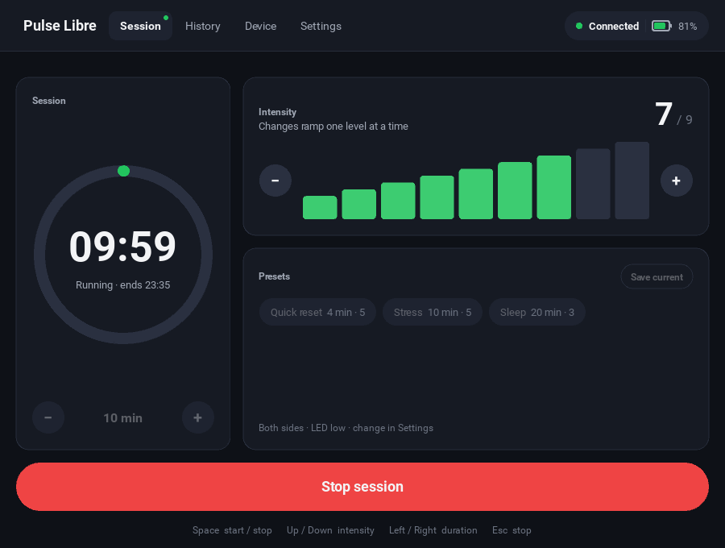

# Pulse-Libre Desktop Application

A Kivy application to control the [Pulsetto device](https://juraj.bednar.io/pulsetto) via Bluetooth Low Energy (BLE). The app allows you to set the strength of the device, start a timer, and monitor battery and charging status.

<!-- jooray-links:start -->
### More from me

**Related projects**

- [PulseLibre](https://github.com/jooray/PulseLibre): mobile app for controlling Pulsetto devices
- [roadstr](https://github.com/jooray/roadstr): road-event reporting over Nostr and MeshCore

**Full project showcase:** Part of [PulseLibre](https://juraj.bednar.io/showcase/#RF-02) in my project showcase, or [all my projects](https://juraj.bednar.io/showcase/).

I write about building things on [my blog](https://juraj.bednar.io/en/blog-en/). I also wrote a cypherpunk novel, [Tamers of Entropy](https://tamersofentropy.net/), and there is a [trailer](https://tamersofentropy.net/#trailer).
<!-- jooray-links:end -->

This app is designed for desktop platforms (macOS, should work on Linux and maybe Windows) and mirrors the functionality of the mobile app available [here](https://github.com/jooray/PulseLibre).


## Screenshot



### UI

A dark, card-based desktop interface with four tabs:

- **Session**: countdown ring, 1-9 intensity meter (click or drag the bars), session length, presets, and a large Start/Stop button. A session keeps running while you browse the other tabs.
- **History**: completed, stopped and interrupted sessions with totals for all time and the last 7 days.
- **Device**: name, model, firmware, address, battery voltage and charging status; connect/disconnect; guarded DFU (firmware update) mode.
- **Settings**: default session length and intensity, connect-on-launch, and preset management.

The header always shows connection and battery status. If a stop command cannot be confirmed (for example the connection dropped mid-session), a warning banner stays up until the device acknowledges the stop.

**Keyboard shortcuts:** `Space` start/stop, `Up`/`Down` intensity, `Left`/`Right` session length, `Esc` stop (Esc never quits the app), `Ctrl+1`-`Ctrl+4` switch tabs.

Settings, presets and history are stored as JSON in Kivy's per-user data directory (e.g. `%APPDATA%\pulselibre` on Windows, `~/Library/Application Support/pulselibre` on macOS).

### Code layout

```
main.py                    entry point (window config, launches the app)
pulselibre/
  device.py                BLE protocol and connection handling (no Kivy dependency)
  session.py               session timer, keep-alive, history records
  storage.py               settings, presets and history persistence
  theme.py                 colour palette and formatting helpers
  widgets.py               reusable themed widgets
  app.py                   app shell: header, tabs, device -> UI state, shortcuts
  screens/                 one module per tab (session, history, device_info, settings)
```

To add a screen, create a module in `pulselibre/screens/`, import it in `screens/__init__.py`, and add it to `TABS` and the `ScreenManager` in `app.py`.


## Features

- Scan and connect to [Pulsetto devices](https://juraj.bednar.io/pulsetto) automatically, with automatic reconnect.
- Set strength levels from 1 to 9; changes ramp one level at a time.
- Timed sessions (default 10 minutes) with presets and a local session history.
- Display battery level, charging status, model and firmware.
- If the connection drops mid-session, the device is told to stop as soon as it reconnects (the device itself keeps stimulating while disconnected).
- Compatible with desktop platforms (Windows, macOS, Linux).

## Protocol

We reverse engineered the protocol of both Pulsetto Lite and Fit devices. There
is no difference between the different session types in the wave they produce,
the only difference is recommended length and the small fact that the Sleep
program starts with the LED dimmed. There are no session type settings in the
app precisely for this reason - just set the time and intensity and you are
good to go.

For those interested, the full protocol documentation is
[here](docs/PULSETTO_PROTOCOL.md).

## Prerequisites

- Python 3.7 or higher
- [Poetry](https://python-poetry.org/docs/#installation) package manager

## Installation

1. **Clone the repository**

   ```bash
   git clone https://github.com/jooray/pulse-libre-desktop.git
   cd pulsetto-libre-desktop
   ```

2. **Install dependencies using Poetry**

   ```bash
   poetry install
   ```

## Running the Application

   ```bash
   poetry run python main.py
   ```
## Usage

- Upon starting, the app searches for a Pulsetto device (this can be turned off in Settings).
- If no device is found, press "Connect to device" to search again.
- Pick a preset or set the session length and intensity (1-9).
- Press "Start session" (or `Space`) to begin; the intensity ramps up to your setting.
- Press "Stop session" (or `Esc`) to stop the device and the timer.

## Why? Backstory

I was stranded in a car in a storm. The storm took out all the cell towers. With nothing
to do, I decided to do some biohacking, chill out, use some Near Infrarred Light and
do some vagal stimulation to remove the stress of freaking wind that was shaking my car
and throwing over reusable bathrooms around me.

I turned the device on, but it needed to login and go to the internet. Which was of course
not working because of the storm.

Why does an electric nerve stimulator need an account and access to the Internet? I sighed.
A few moments later, I wanted to learn about BLE hacking and reverse engineering. The code
was written mostly by ChatGPT anyway, but I did some nice reverse engineering of the protocol.
The result is this micro app. Have fun.

## Information about Pulsetto device

The device's original app has multiple modes (Stress, Pain, Burnout, ...), but
they are actually all the same, just with different recommendations on how often to do
them and different program lengths. There is no difference in what the device does.

The only thing that you set on your device is the strength level (1-9) and the
app starts a timer. (and LED intensity)

Get your [Pulsetto device](https://juraj.bednar.io/pulsetto).
